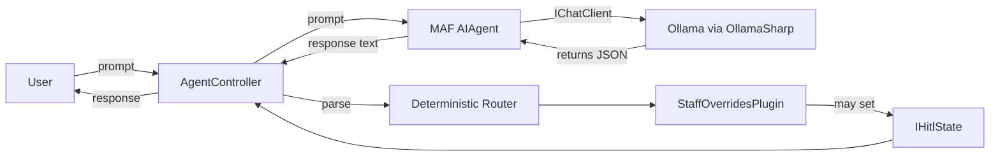

# AgenticWorkflowPoC

Last updated: 2026-08-31

Description
-----------
AgenticWorkflowPoC is a proof-of-concept demonstrating a safe, deterministic pattern for integrating LLMs into business flows. Instead of allowing the model to directly invoke tools, the LLM returns structured JSON and the server deterministically decides which plugin to execute.

Goals
-----
- Prevent the LLM from autonomously invoking functions (reduce hallucinations).
- Keep Human-in-the-Loop (HITL) state per-request via `IHitlState` (scoped DI).
- Use Microsoft.Extensions.AI (`IChatClient`) and Microsoft Agent Framework (`AIAgent`) for provider-neutral inference and agent execution.
- Provide unit and E2E tests that do not require external services (E2E replaces `IChatClient` with a deterministic fake).

Repository structure
--------------------
- `src/AgenticWorkflowPoC.Api` — API, controllers and Agent Framework/MEAI setup.
- `src/AgenticWorkflowPoC.Plugins` — plugins and `IHitlState` (scoped implementation).
- `src/AgenticWorkflowPoC.Core` — entities and interfaces.
- `src/AgenticWorkflowPoC.Infrastructure` — persistence (SQL skeleton).
- `tests/AgenticWorkflowPoC.Tests` — unit and integration tests.

Requirements
------------
- .NET 10 SDK
- (Optional) Local Ollama at `http://localhost:11434` with a compatible model (e.g. `llama3.1`) for real integrated runs.

Quickstart (local)
------------------
1. Restore dependencies and run tests:

```bash
dotnet restore
dotnet test AgenticWorkflowPoC.sln
```

2. Run the API locally:

```bash
dotnet run --project src/AgenticWorkflowPoC.Api
```

By default the app listens on `http://localhost:5000` (and `https://localhost:5001` if configured). If using Ollama, verify `Ollama:Endpoint` and `Ollama:Model` in `appsettings.json` or environment variables.

Example requests
----------------

Invoke (main flow):

```bash
curl -s -X POST http://localhost:5000/api/agent/invoke \
  -H "Content-Type: application/json" \
  -d '{"sessionId":"7e0d34ab-41cd-4f87-b6d2-ef1328c17939","prompt":"Change EMP-REQ-001 availability to 2026-09-01T09:00:00Z"}'
```

Example response (suspended due to conflict):

```json
{
  "status": "Suspended",
  "message": "A shift conflict was detected for staff EMP-REQ-001.",
  "sessionId": "7e0d34ab-41cd-4f87-b6d2-ef1328c17939"
}
```

Resume (after human decision):

```bash
curl -s -X POST http://localhost:5000/api/agent/resume/7e0d34ab-41cd-4f87-b6d2-ef1328c17939 \
  -H "Content-Type: application/json" \
  -d '{"isApproved":true}'
```

The resume route uses the same GUID as the invoke request. Approval executes the stored action through C#; rejection marks it as rejected without calling the model.

Design notes
------------
- Deterministic Router: the LLM returns a strict extraction payload; `ExtractionValidator` rejects unknown fields, invalid types, and invalid dates before `AgentService` invokes C# domain logic.
- `IHitlState` is request-scoped and signals a suspension. The reason and validated pending action are persisted separately in `dbo.HitlSessions` before the API returns HTTP 202.
- Resume transitions a session only from `PendingReview`, so repeated approvals or rejections are rejected. The approved action runs through C# without another LLM call.
- With `USE_FAKE_CHAT=true`, the application uses a deterministic fake chat service and an in-memory HITL repository. For SQL-backed runs, configure the connection string and apply `scripts/001-create-hitl-sessions.sql` to an existing `AgenticPoC` database; fresh databases also get this table from `schema.sql`.
- Resume currently executes in the approval HTTP request. A background worker/Channel, durable queue recovery, and administrative authentication are not implemented yet; do not expose the endpoint as an authenticated admin workflow.

Simplified flow (Mermaid)



Basic test flow (CI-friendly)
---------------------------
1. Restore and run the test suite locally:

```bash
dotnet restore
dotnet test AgenticWorkflowPoC.sln --no-build
```

2. To run only tests in the test project:

```bash
dotnet test tests/AgenticWorkflowPoC.Tests --filter FullyQualifiedName~AgentController
```

Notes
-----
- E2E tests are deterministic: they replace `IChatClient` with a fake implementation so CI doesn't require a running LLM.
- If you plan to run the API against a real LLM, be mindful of rate limits and credentials.

Contributing
------------
See `CONTRIBUTING.md` for PR and code-style guidance.

License
-------
Add a `LICENSE` file if you want to publish this repository.

Contact
-------
Open issues or PRs at https://github.com/emimaldo/agentic-workflow-poc

Important notes (2026-09-05)
-----------------------------
- The controller logic was refactored into `IAgentService` / `AgentService` to enforce SRP. Business logic and JSON parsing now live in `src/AgenticWorkflowPoC.Api/Services`.
- The model extraction prompt is centralized in `AgentDefaults.ExtractionPrompt`.
- The repository history was rewritten to remove accidentally committed secrets. If you cloned before 2026-09-05, please re-clone:

```bash
rm -rf agentic-workflow-poc
git clone https://github.com/emimaldo/agentic-workflow-poc.git
```

Run the full test suite after cloning:

```bash
dotnet restore
dotnet test AgenticWorkflowPoC.sln
```
