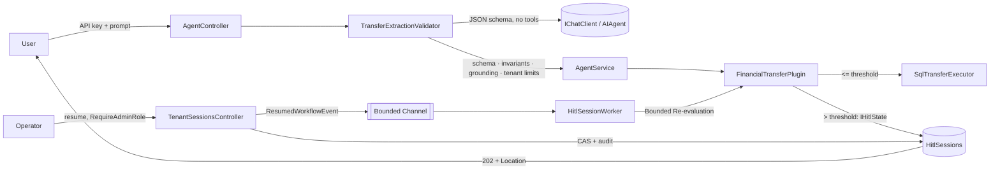

# AgenticWorkflowPoC

Last updated: 2026-11-14

Official companion Proof of Concept for the book **"Building Enterprise Agentic Workflows in .NET"**.

Description
-----------
A deterministic agentic router on .NET 10: the LLM is used strictly as a **semantic parser** that turns a free-text
transfer instruction into a schema-constrained JSON payload. Deterministic C# code owns everything else:
authentication, the tenant context, validation, routing, Human-in-the-Loop (HITL) suspension, re-evaluation and
atomic persistence. Tool calling is disabled (`ChatToolMode.None`); `ChatToolMode.Auto` is never used.

Reference scenario (FinTech)
----------------------------
A tenant writes *"Transfer 12500.00 EUR to DE89 3704 0044 0532 0130 00"*.

1. **Extraction (Ch. 2)** — MEAI/MAF asks the model for `TransferRequestPayload { destinationAccount, amount, currency }`
   using `ChatResponseFormat.ForJsonSchema<T>()`, temperature 0 and no tools.
2. **Validation (Ch. 2)** — `IExtractionValidator<EnrichedTransferCommand>` applies four layers:
   schema (unknown keys rejected) → invariants (IBAN mod-97, ISO 4217 minor units) → grounding (IBAN and amount must
   literally appear in the request; ambiguous `12.500` is rejected, not guessed) → tenant limits.
   The `TenantId` and the **source account** come from the authenticated tenant context, never from the model.
3. **Closed routing (Ch. 2–3)** — `200` executed · `202 Accepted` + `Location` suspended for review · `422` rejected
   (`application/problem+json` with typed codes).
4. **HITL (Ch. 3)** — above the tenant threshold (default 10,000) the plugin mutates the request-scoped `IHitlState`;
   the immutable `SerializedContext` is persisted **before** the 202 is returned.
5. **Resume (Ch. 3)** — an operator (`RequireAdminRole`) approves; the approval is stored atomically (CAS + audit),
   then a `ResumedWorkflowEvent` is written to a bounded `Channel` (`BoundedChannelFullMode.Wait`) to wake the worker.
6. **Bounded Re-evaluation (Ch. 3)** — before debiting, the worker re-runs the same deterministic rules against fresh
   ledger state (balance, freeze, blocked beneficiary, daily limit, current tenant policy). If the world changed, the
   session ends `Invalidated` and nothing is executed. No LLM call happens on this path.
7. **Atomic execution** — one `SERIALIZABLE` transaction with `UPDLOCK, HOLDLOCK`: account lock, idempotency by
   operation id, final guards, debit and transfer record.

Repository structure
--------------------
- `src/AgenticWorkflowPoC.Api` — controllers, router (`AgentService`), extraction validator, HITL worker, DI.
- `src/AgenticWorkflowPoC.Plugins` — `FinancialTransferPlugin`, `TransferPolicy`, `IHitlState`, ledger contracts.
- `src/AgenticWorkflowPoC.Core` — entities (`TransferRequestPayload`, `EnrichedTransferCommand`, `HitlSession`, `TenantPolicy`) and interfaces.
- `src/AgenticWorkflowPoC.Infrastructure` — Dapper + T-SQL persistence (`SqlLedger`, `SqlHitlSessionRepository`).
- `tests/AgenticWorkflowPoC.Tests` — zero-token unit/E2E tests (`FakeChatClient`) and SQL Server tests (Testcontainers).

Requirements
------------
- .NET 10 SDK
- (Optional) Docker — enables the SQL Server integration tests; they are skipped without it.
- (Optional) Ollama at `http://localhost:11434` (e.g. `llama3.1`) and SQL Server for real, durable runs.

Quickstart (zero-token, in-memory)
----------------------------------
```bash
dotnet test AgenticWorkflowPoC.sln
```

```bash
export API_KEY='replace-with-a-local-secret'
export Authentication__ApiKeys__0__Key="$API_KEY"
export Authentication__ApiKeys__0__TenantId='tenant-local'
export Authentication__ApiKeys__0__Role='Admin'
./scripts/run-dev.sh
```

`run-dev.sh` enables `USE_FAKE_CHAT=true` (deterministic model, in-memory HITL store and ledger) and passes a dev
tenant policy for `tenant-local` (operating account `OPS-EUR-001`, 50,000 EUR). The fake model always answers with a
12,500.00 EUR transfer to `DE89370400440532013000` (set `FAKE_HIGH_VALUE_TRANSFER=false` for 250.00 EUR), so prompts
must contain those literals to pass grounding. **In-memory mode is not durable across restarts.**

Example requests
----------------
Invoke — suspended for review (HTTP 202 + `Location`):

```bash
curl -i -X POST http://localhost:5002/api/agent/invoke \
  -H "X-Api-Key: $API_KEY" -H "Content-Type: application/json" \
  -d '{"sessionId":"7e0d34ab-41cd-4f87-b6d2-ef1328c17939","prompt":"Transfer 12500.00 EUR to DE89 3704 0044 0532 0130 00"}'
```

```http
HTTP/1.1 202 Accepted
Location: http://localhost:5002/api/v1/tenants/tenant-local/sessions/7e0d34ab-41cd-4f87-b6d2-ef1328c17939

{"sessionId":"7e0d34ab-...","status":"Suspended","message":"Transfer of 12,500.00 EUR exceeds the approval threshold of 10,000.00; manual sign-off required."}
```

Poll the session, then approve it as an operator:

```bash
curl -s http://localhost:5002/api/v1/tenants/tenant-local/sessions/7e0d34ab-41cd-4f87-b6d2-ef1328c17939 \
  -H "X-Api-Key: $API_KEY"
```

```bash
curl -i -X POST http://localhost:5002/api/v1/tenants/tenant-local/sessions/7e0d34ab-41cd-4f87-b6d2-ef1328c17939/resume \
  -H "X-Api-Key: $API_KEY" -H "Content-Type: application/json" -d '{"isApproved":true}'
```

The session moves `PendingReview → Approved → Processing → Completed` (or `Invalidated` with an `invalidationReason`
if re-evaluation fails). A hallucinated field, an ungrounded IBAN/amount, or insufficient funds returns `422`:

```json
{"status":422,"title":"The request was rejected by deterministic validation.","errors":[{"code":"Ungrounded","message":"The amount does not appear in the request."}]}
```

SQL Server (durable mode)
-------------------------
- Fresh database: run `schema.sql`, then `scripts/seed-dev.sql` for dev data.
- Upgrading an existing database: apply `scripts/002-…`, `scripts/003-fintech-ledger.sql` (creates the ledger, drops the
  former staff demo table), `scripts/004-hitl-serialized-context.sql` and `scripts/005-hitl-tenant-scoped-key.sql`
  (HITL key becomes `(TenantId, SessionId)`), in order. All are idempotent.
- Configure `ConnectionStrings:AgenticDatabase`, `TenantPolicies:{tenantId}:*` and the API keys outside source control.

Configuration reference
-----------------------
| Key | Purpose |
|---|---|
| `Authentication:ApiKeys:{n}:Key / TenantId / Role / Subject` | API keys → tenant claim, role (`Admin` for operators) and audit subject. PoC mechanism, not a substitute for an identity provider. |
| `TenantPolicies:{tenantId}:OperatingAccountId` | Account debited for the tenant (never taken from the prompt). Unconfigured tenants fail closed. |
| `TenantPolicies:{tenantId}:HitlThreshold / MaxPerTransfer / DailyLimit / AllowedCurrencies:{n}` | Deterministic financial policy. |
| `HitlWorker:ChannelCapacity / SweepInterval` | Bounded resume-signal channel and durable-queue sweep (default 1024 / 30 s). |
| `USE_FAKE_CHAT`, `FAKE_HIGH_VALUE_TRANSFER`, `DevLedger:Accounts:{n}:*` | Zero-token local mode. |

Flow (Mermaid)
--------------



Testing
-------
- Unit/E2E tests are zero-token: `FakeChatClient` replaces the model and records the `ChatOptions` it receives.
- `Integration/SqlPersistenceTests` run the shipped T-SQL against SQL Server 2022 via Testcontainers (Docker required;
  set `SKIP_DOCKER_TESTS=true` to skip them explicitly).

```bash
dotnet test tests/AgenticWorkflowPoC.Tests --filter FullyQualifiedName~BoundedReevaluation
```

Contributing
------------
See `CONTRIBUTING.md` for PR and code-style guidance.

License
-------
Add a `LICENSE` file if you want to publish this repository.

Contact
-------
Open issues or PRs at https://github.com/emimaldo/agentic-workflow-poc

Important notes (2026-09-05)
-----------------------------
- The controller logic was refactored into `IAgentService` / `AgentService` to enforce SRP. Business logic and JSON parsing now live in `src/AgenticWorkflowPoC.Api/Services`.
- The model extraction prompt is centralized in `AgentDefaults.ExtractionPrompt`.
- The repository history was rewritten to remove accidentally committed secrets. If you cloned before 2026-09-05, please re-clone:

```bash
rm -rf agentic-workflow-poc
git clone https://github.com/emimaldo/agentic-workflow-poc.git
```

Run the full test suite after cloning:

```bash
dotnet restore
dotnet test AgenticWorkflowPoC.sln
```
