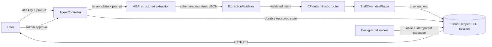

# AgenticWorkflowPoC

Last updated: 2026-10-24

Description
-----------
AgenticWorkflowPoC is a proof-of-concept demonstrating a safe, deterministic pattern for integrating LLMs into business flows. Instead of allowing the model to directly invoke tools, the LLM returns structured JSON and the server deterministically decides which plugin to execute.

Goals
-----
- Prevent the LLM from autonomously invoking functions (reduce hallucinations).
- Keep Human-in-the-Loop (HITL) state per-request via `IHitlState` (scoped DI).
- Use Microsoft.Extensions.AI (`IChatClient`) for provider-neutral structured extraction and keep routing/execution under C# control.
- Provide unit and E2E tests that do not require external services (E2E replaces `IChatClient` with a deterministic fake).

Repository structure
--------------------
- `src/AgenticWorkflowPoC.Api` — API, controllers and Agent Framework/MEAI setup.
- `src/AgenticWorkflowPoC.Plugins` — plugins and `IHitlState` (scoped implementation).
- `src/AgenticWorkflowPoC.Core` — entities and interfaces.
- `src/AgenticWorkflowPoC.Infrastructure` — persistence (SQL skeleton).
- `tests/AgenticWorkflowPoC.Tests` — unit and integration tests.

Requirements
------------
- .NET 10 SDK
- (Optional) Local Ollama at `http://localhost:11434` with a compatible model (e.g. `llama3.1`) for real integrated runs.

Quickstart (local)
------------------
1. Restore dependencies and run tests:

```bash
dotnet restore
dotnet test AgenticWorkflowPoC.sln
```

2. Run the API locally:

```bash
export USE_FAKE_CHAT=true
export API_KEY='replace-with-a-local-secret'
export ADMIN_API_KEY="$API_KEY"
export Authentication__ApiKeys__0__Key="$API_KEY"
export Authentication__ApiKeys__0__TenantId='tenant-local'
export Authentication__ApiKeys__0__Role='Admin'
dotnet run --project src/AgenticWorkflowPoC.Api
```

By default the app listens on `http://localhost:5000` (and `https://localhost:5001` if configured). If using Ollama, verify `Ollama:Endpoint` and `Ollama:Model` in `appsettings.json` or environment variables.
The API requires an `X-Api-Key` header. Supply keys through configuration/environment variables; never commit real keys. This API-key handler is a PoC mechanism, not a substitute for an enterprise identity provider or a production key-management service.

Example requests
----------------

Invoke (main flow):

```bash
curl -s -X POST http://localhost:5000/api/agent/invoke \
  -H "X-Api-Key: $API_KEY" \
  -H "Content-Type: application/json" \
  -d '{"sessionId":"7e0d34ab-41cd-4f87-b6d2-ef1328c17939","prompt":"Change EMP-REQ-001 availability to 2026-09-01T09:00:00Z"}'
```

Example response (suspended due to conflict):

```json
{
  "status": "Suspended",
  "message": "A shift conflict was detected for staff EMP-REQ-001.",
  "sessionId": "7e0d34ab-41cd-4f87-b6d2-ef1328c17939"
}
```

Resume (after human decision):

```bash
curl -s -X POST http://localhost:5000/api/agent/resume/7e0d34ab-41cd-4f87-b6d2-ef1328c17939 \
  -H "X-Api-Key: $ADMIN_API_KEY" \
  -H "Content-Type: application/json" \
  -d '{"isApproved":true}'
```

The resume route uses the same GUID as the invoke request. An admin key approves or rejects the session. Approval returns HTTP 202 after durably queuing the operation; the background worker executes it without calling the model.

Design notes
------------
- **Stage 0 — vertical slice:** the reference scenario is changing staff availability. The model extracts only `staffId` and `date`; C# validates, applies the conflict rule, and selects completion or HITL.
- **Stage 1 — extraction contract:** MEAI requests a JSON-schema-constrained response; `ExtractionValidator` independently rejects unknown fields, missing or oversized values, invalid types, and dates without an explicit timezone. No tools are provided to the model.
- **Stage 2 — deterministic execution:** a C# plugin owns the business decision. The development conflict rule remains simulated (`EMP-REQ*`); SQL-backed execution records the accepted override using the session ID as its idempotency key.
- **Stage 3 — identity and tenant boundary:** the tenant is derived from an authenticated API-key configuration entry, never from the prompt or request body. HITL reads and transitions are tenant-scoped; resumption requires the `Admin` role.
- **Stage 4 — recoverable HITL:** pending actions are persisted before returning HTTP 202. Approval transitions to `Approved`; a hosted worker claims work with a two-minute lease, retries at most three times, and can reclaim stale `Processing` work. The SQL executor is idempotent by session ID.
- Configure one or more API keys outside source control using `Authentication__ApiKeys__0__Key`, `Authentication__ApiKeys__0__TenantId`, and `Authentication__ApiKeys__0__Role` (`Admin` for approval). Different entries can represent different tenants.
- The quickstart enables `USE_FAKE_CHAT=true` to avoid requiring Ollama or SQL Server. For a real model and durable SQL-backed processing, configure `Ollama:Endpoint`, `Ollama:Model`, and the `AgenticDatabase` connection string as well.
- For a fresh database, run `schema.sql`. To upgrade the earlier HITL schema, apply `scripts/002-hitl-tenant-and-work-queue.sql`; `scripts/001-create-hitl-sessions.sql` is retained for older setups.
- With `USE_FAKE_CHAT=true`, the application uses a deterministic fake model client and in-memory HITL/execution repositories. **This mode is for local demonstration only and is not durable across process restarts.**
- The SQL executor writes the demonstration operation to `dbo.StaffAvailabilityOverrides`; it is not connected to a real staff-management system. Replace the simulated conflict rule and this demonstration table with the real domain service before production.

Simplified flow (Mermaid)



Basic test flow (CI-friendly)
---------------------------
1. Restore and run the test suite locally:

```bash
dotnet restore
dotnet test AgenticWorkflowPoC.sln --no-build
```

2. To run only tests in the test project:

```bash
dotnet test tests/AgenticWorkflowPoC.Tests --filter FullyQualifiedName~AgentController
```

Notes
-----
- E2E tests are deterministic: they replace `IChatClient` with a fake implementation so CI doesn't require a running LLM.
- If you plan to run the API against a real LLM, be mindful of rate limits and credentials.

Contributing
------------
See `CONTRIBUTING.md` for PR and code-style guidance.

License
-------
Add a `LICENSE` file if you want to publish this repository.

Contact
-------
Open issues or PRs at https://github.com/emimaldo/agentic-workflow-poc

Important notes (2026-09-05)
-----------------------------
- The controller logic was refactored into `IAgentService` / `AgentService` to enforce SRP. Business logic and JSON parsing now live in `src/AgenticWorkflowPoC.Api/Services`.
- The model extraction prompt is centralized in `AgentDefaults.ExtractionPrompt`.
- The repository history was rewritten to remove accidentally committed secrets. If you cloned before 2026-09-05, please re-clone:

```bash
rm -rf agentic-workflow-poc
git clone https://github.com/emimaldo/agentic-workflow-poc.git
```

Run the full test suite after cloning:

```bash
dotnet restore
dotnet test AgenticWorkflowPoC.sln
```
